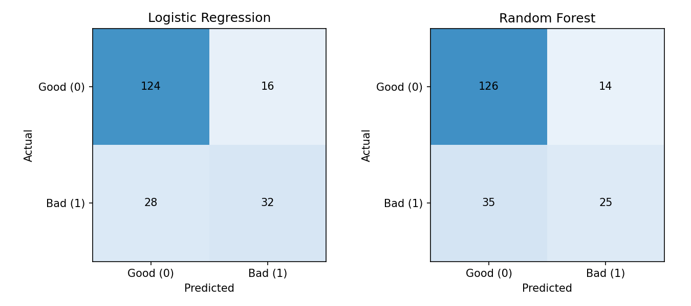

# Tabular Machine Learning Model Validation

## Overview

A reproducible validation benchmark comparing Logistic Regression and Random Forest on UCI German Credit data. The project evaluates discrimination, generalization and asymmetric error costs using shared data splits, preprocessing pipelines and auditable reports.

Built with Python, pandas, NumPy, scikit-learn, matplotlib and pytest.

## Key Findings

- **Random Forest shows a substantial generalization gap:** training ROC-AUC is 1.0000 versus 0.7848 on the holdout, a gap of 0.2152. This is consistent with possible overfitting; one split does not establish the cause.
- **Accuracy does not capture decision cost:** at the fixed 0.5 threshold, Logistic Regression and Random Forest incur costs of 156 and 189, respectively, versus 140 for always predicting bad credit risk.
- **Ranking performance and decision rules need separate evaluation.** The constant baseline exposes a limitation of the fixed-threshold policies under the supplied costs; it is not a recommendation to reject every applicant.

## Dataset

[UCI Statlog German Credit, dataset 144](https://archive.ics.uci.edu/dataset/144/statlog+german+credit+data) contains 1,000 records and 20 features: 7 numerical and 13 categorical. This project uses the original mixed-format `german.data`, not the expanded numerical variant.

| Original UCI label | Project label | Records |
|---|---|---:|
| 1 — good credit risk | 0 — negative | 700 |
| 2 — bad credit risk | 1 — positive | 300 |

The verified snapshot has no missing values or completely duplicated feature rows. Codes such as `A65` (unknown/no savings account) remain valid categories.

Unmodified source files are included. The loader verifies the data's SHA-256 on every run and downloads from the official UCI archive only if the local file is absent. Download or checksum failures stop execution; there is no synthetic fallback.

**Attribution:** Hofmann, H. (1994). *Statlog (German Credit Data)*. UCI Machine Learning Repository. [DOI: 10.24432/C5NC77](https://doi.org/10.24432/C5NC77). UCI lists the dataset under [CC BY 4.0](https://creativecommons.org/licenses/by/4.0/); retain attribution and license information and identify adaptations when redistributing it. Column names and target labels are transformed in memory.

See [dataset provenance](data/README.md) and the [original feature dictionary](data/raw/german.doc).

## Methodology

### Evaluation protocol

- Fixed seed **42** and a stratified **80/20 split**: 800 training records and 200 holdout records, preserving the 70/30 class proportions.
- Training-only, shuffled **5-fold StratifiedKFold** with identical folds for both models.
- Predeclared settings: Logistic Regression uses `C=1`, `solver="lbfgs"`, `max_iter=2000`; Random Forest uses 200 trees and unlimited depth. Other settings follow the pinned scikit-learn defaults.
- No hyperparameter search, class reweighting or threshold optimization. The holdout is not used to select models, preprocessing settings or thresholds.

### Preprocessing and leakage prevention

A `ColumnTransformer` separates numerical and categorical features within each model's `Pipeline`:

| Feature type | Processing |
|---|---|
| Numerical | Median imputation; standardization for Logistic Regression only |
| Categorical | Most-frequent imputation; one-hot encoding; unseen categories mapped to all-zero indicators |

Each CV fold fits the entire pipeline only on its training partition. Validation rows use those fitted transformations. Final pipelines fit on all training records before holdout evaluation; no learned preprocessing uses holdout data.

### Metrics and costs

Predictions use **P(bad) ≥ 0.5**. Precision, recall and F1 treat **bad credit risk as positive**; ROC-AUC uses its predicted probability. Undefined precision/F1 are set to zero. Confusion matrices use actual rows and predicted columns ordered `[good, bad]`: `[[TN, FP], [FN, TP]]`.

The UCI benchmark assigns cost 1 to a false positive and 5 to a false negative:

```text
Total cost = FP + 5 × FN
Mean cost  = total cost / number of records
```

These are relative benchmark units, not monetary losses. The fixed 0.5 threshold is not cost-optimal by construction. A theoretical 1/6 threshold assumes calibrated probabilities and applicable costs, neither of which is established here.

## Results

All values below come from the [generated validation report](reports/validation_report.md).

### Holdout performance

| Model | Accuracy | Precision | Recall | F1 | ROC-AUC | Total cost | Mean cost |
|---|---:|---:|---:|---:|---:|---:|---:|
| Logistic Regression | 0.7800 | 0.6667 | 0.5333 | 0.5926 | 0.8040 | 156 | 0.7800 |
| Random Forest | 0.7550 | 0.6410 | 0.4167 | 0.5051 | 0.7848 | 189 | 0.9450 |

### Training and cross-validation

| Model | Training ROC-AUC | CV ROC-AUC, mean ± SD | Holdout ROC-AUC |
|---|---:|---:|---:|
| Logistic Regression | 0.8329 | 0.7706 ± 0.0598 | 0.8040 |
| Random Forest | 1.0000 | 0.7874 ± 0.0422 | 0.7848 |

Training scores measure fit on observed data, not independent performance. CV variability is the sample standard deviation across folds (`ddof=1`), not a confidence interval. The full report includes all training and CV metrics.

### Constant decision baselines

| Holdout rule | Accuracy | Bad-risk recall | Total cost | Mean cost |
|---|---:|---:|---:|---:|
| Always predict good | 0.7000 | 0.0000 | 300 | 1.5000 |
| Always predict bad | 0.3000 | 1.0000 | 140 | 0.7000 |

Logistic Regression misses 28 bad risks; Random Forest misses 35. These false negatives contribute 140 and 175 cost units, respectively, explaining why better accuracy than the constant baselines does not imply lower cost.



## Reproduction

Use **Python 3.12**; the recorded environment is **3.12.14**. From the repository root, with `python3.12` installed and available on your PATH:

```bash
python3.12 -m venv .venv
source .venv/bin/activate
python -m pip install -r requirements-lock.txt
python scripts/inspect_data.py
python -m pytest -q
python -m scripts.benchmark
cat reports/validation_report.md
```

On Windows PowerShell, create the environment with `py -3.12 -m venv .venv`, activate it with `.venv\Scripts\Activate.ps1`, and use `Get-Content reports/validation_report.md` to read the report. The remaining `python` commands are unchanged. In VS Code, select the `.venv` interpreter and open the Markdown report preview.

For a quick run that keeps the published report intact:

```bash
python -m scripts.benchmark --folds 2 --trees 8 --output-dir reports/smoke
```

`requirements.txt` pins core dependencies and compatible SciPy/pyparsing versions; `requirements-lock.txt` records the complete dependency set. Fixed seeds and versions support reproducibility, but do not guarantee identical floating-point results across platforms.

The test suite covers schema and target mapping, missing-value handling, split separation, metric and cost calculations, unseen categories, preprocessing boundaries and repeatable end-to-end execution. See [verification details](VERIFICATION.md).

## Project Structure

```text
├── README.md
├── VERIFICATION.md
├── requirements.txt
├── requirements-lock.txt
├── pytest.ini
├── data/
│   ├── README.md
│   └── raw/                     # Official data and feature dictionary
├── scripts/
│   ├── inspect_data.py          # Verified loading and data checks
│   ├── benchmark.py             # Pipelines, CV and holdout evaluation
│   └── reporting.py             # Report and confusion-matrix generation
├── tests/
│   ├── test_data.py
│   └── test_benchmark.py
└── reports/
    ├── data_inspection.json
    ├── dataset_description.txt
    ├── benchmark_results.json   # Environment, settings, row IDs and metrics
    ├── holdout_predictions.csv  # Labels, probabilities and predictions
    ├── confusion_matrices.png
    └── validation_report.md
```

## Limitations

- The small historical German dataset was donated in 1994 and uses legacy categories, including Deutsche Mark bands. It does not establish applicability to contemporary lending populations.
- Random splitting does not measure performance on future periods or new institutions. Unique rows do not establish customer independence; reliable grouping and temporal metadata are not used.
- Personal status/sex, age and foreign-worker fields raise fairness and proxy concerns. No subgroup fairness, compliance, calibration or drift evaluation has been completed.
- Injected missing-value tests verify pipeline mechanics, not robustness to realistic missingness. Aggregate errors do not explain individual failure causes.
- Findings are limited to two classical models, one dataset and one holdout split. They do not validate deep learning models or establish suitability for banking deployment or production use.

## Future Work

- Evaluate probability calibration and cost-aware threshold selection using training data only.
- Compare regularization and tree-complexity settings through training-only model selection, with nested CV where appropriate.
- Analyze subgroup performance and error patterns, accounting for limited sample sizes and proxy variables.
- Evaluate temporal, institutional and distribution-shift robustness when suitable data becomes available.

Repeated development decisions based on this holdout would require a new independent final evaluation set.
